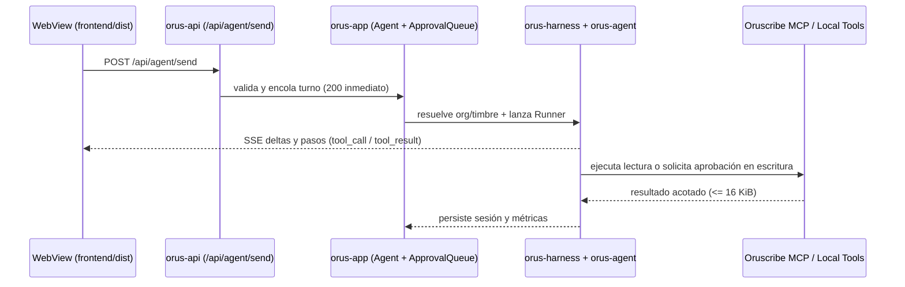

# Arquitectura de Oruscribe Agente

Oruscribe Agente es un workspace Rust puro (12 crates de producto + `tools/fake-provider`) que produce un único binario de escritorio (`orus-shell`) para **Windows y Linux**.

## Modelo de ejecución

1. **Shell nativo (`orus-shell`)**: garantiza instancia única, levanta el servidor HTTP local en `127.0.0.1:0`, genera un token aleatorio de 256 bits por arranque (intercambiado por una cookie `HttpOnly` y protegido por validación de `Origin`), abre un WebView nativo (`WebView2` en Windows, `WebKitGTK 4.1` en Linux) y monta el icono en la bandeja del sistema.
2. **Servidor embebido (`orus-server`)**: fusiona el router HTTP de `orus-api` (`/api/*`) con los activos estáticos de `frontend/dist` embebidos en el binario. Su binario `orus-server` sirve para inspeccionar la interfaz en un navegador durante desarrollo.
3. **Borde HTTP (`orus-api`)**: adaptadores finos sobre `orus-app`, streaming de eventos por SSE (`/api/events`), subidas multipart, diagnóstico con redacción de secretos y proxy opcional de voz compatible con OpenAI (`/api/agent/transcribe`, `/api/agent/speak`).
4. **Estado y coordinación (`orus-app`)**: gestiona sesión OAuth, conexión MCP, cola de aprobaciones (`ApprovalQueue`), conversaciones persistidas, vigilancia del timbre (`watch.rs`) y despertar autónomo acotado (`wake.rs`).
5. **Motor del agente (`orus-harness` + `orus-agent` + `orus-tools`)**:
   - Carga instrucciones (`AGENTS.md`, `ORUSCRIBE.md`) y `SKILL.md`.
   - Expone herramientas MCP de Oruscribe (con tope anti-cuota en lecturas) y herramientas locales confinadas a las carpetas permitidas (`read`, `write`, `edit`, `bash`).
   - Aplica la política de permisos (`ask`, `readonly`, `autonomous`) y registra escrituras en un diario reversible (`journal`).
6. **Organización, identidad y entrega (`orus-org`, `orus-auth`, `orus-config`, `orus-install`, `orus-core`)**:
   - `orus-org`: cliente MCP Streamable HTTP (`rmcp`) + timbre en vivo (`doorbell`).
   - `orus-auth`: OAuth 2.1 con PKCE y almacenamiento de credenciales en el llavero del sistema.
   - `orus-config`: carpeta de datos aislada por usuario, idioma y `settings.json`.
   - `orus-install`: instalación por usuario en Windows/Linux, manifiestos firmados con Ed25519 y binario `signmanifest`.
   - `orus-core`: tipos compartidos de mensajes, llamadas a herramientas y eventos.

## Flujo de un turno del agente

## Decisiones clave

- **Rust puro sin C++/CMake**: se retiró `whisper-rs` (`orus-voice`) para mantener compilación rápida y portable en cualquier Windows o Linux y CI verde sin dependencias nativas frágiles. El historial previo se conserva en el tag `backup/pre-poda-2026-11-23`.
- **Sin duplicación de motores de herramientas**: las herramientas locales en escritorio son las 4 de Pi (`read`, `write`, `edit`, `bash`), con validación de rutas canónicas, diario reversible (`journal`) y corte del árbol de procesos al vencer timeout.
- **Protección de permisos locales**: ninguna herramienta local (`read`, `write`, `edit`, `bash`) puede aprobarse globalmente como regla permanente `"tool"`.
- **Tráfico estricto hacia Oruscribe (MCP + Timbre) y cuota dura anti-ráfagas**:
  - La app habla con la plataforma únicamente mediante **MCP Streamable HTTP** (`orus-org::Client`), **Timbre Realtime WebSocket** (`orus-org::doorbell`), **OAuth PKCE** (`orus-auth`), subidas por URL prefirmada (`subidas.rs`) y, solo en turnos explícitos del usuario con `IA de Oruscribe`, `POST /functions/v1/chat-agent`.
  - `orus-org::Client` impone un presupuesto global por ventana deslizante (`60` llamadas/minuto y `400` llamadas/hora por proceso), cachea `tool_specs` durante 10 minutos y devuelve `OrgError::RateLimited` → HTTP `429 Too Many Requests`.
  - Con el timbre conectado (`R.connOn`), el frontend apaga el sondeo periódico del chat (`CHAT_POLL_MS` pasa a respaldo cada 15 min solo si cae el timbre) y ante cualquier `429` aplica un backoff mínimo de 60 s sin disparar cargas secundarias.
- **Contrato de herramientas Pi en `CloudBrain` (`/functions/v1/chat-agent`)**:
  - Con `Mi clave`, las 4 herramientas Pi (`read`, `write`, `edit`, `bash`) se ejecutan hoy localmente al 100 % (hasta 40 pasos/turno).
  - Con `IA de Oruscribe`, si la persona autoriza carpetas locales, `CloudBrain` envía las 4 herramientas Pi en `tools` (formato OpenAI `{"type":"function","function":{"name","description","parameters"}}`) y acepta `tool_calls` en la respuesta JSON (`{"content":"","tool_calls":[...]}`), reenviando resultados con `role: "tool"` y `tool_call_id`.
  - Si el backend `/chat-agent` aún rechaza `tools` con HTTP `400`/`422`, `CloudBrain` desactiva `tools` en memoria y reintenta automáticamente una vez en modo solo texto clásico sin romper la conversación.
